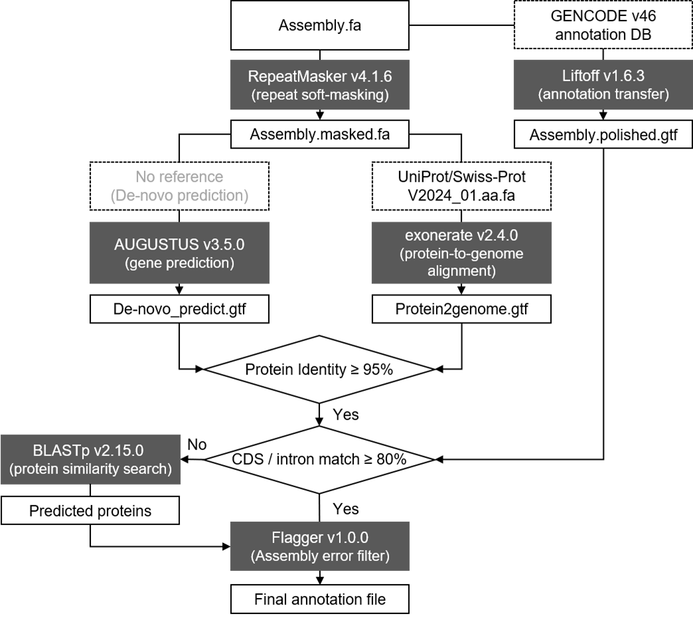

# 2.Ensemble_gene_annotation.sh

The ensemble gene annotation workflow identifies protein-coding genes in
haplotype-resolved assemblies while reducing false-positive predictions.
It follows the hybrid gene-annotation strategy described for Asian
Pangenome Project phase 1 (APGp1) (Wu et al., 2026), combining `de novo` prediction,
protein-to-genome alignment and reference annotation transfer.
The workflow consists of seven stages using RepeatMasker, AUGUSTUS,
Exonerate, Liftoff, BLASTp and HMM-Flagger classification data.

AUGUSTUS-derived candidates are first supported by human Swiss-Prot
proteins and compared with GENCODE v46 annotations transferred from
GRCh38. Genes not represented in the Liftoff annotation can be added
after protein homology screening. Only loci whose entire genomic spans
are classified as haploid by the corresponding assembly-specific
HMM-Flagger BED are retained. The separate copy-number gain (CNG)
tables summarize the resulting annotation across sample groups.

This script can execute the native annotation tools (`RUN_MODE=tools`)
or validate and integrate previously generated tool outputs
(`RUN_MODE=outputs`). It does not independently run HMM-Flagger;
the per-assembly classification BED is required as an input.



Part of the [KPR-pipeline](../README.md) repository.

---

## 1. Set up

### 1.1 Software

Use the following versions for reproducing the described workflow:

| Tool | Version | Role |
|---|---|---|
| RepeatMasker | 4.1.6 | Repetitive-sequence soft masking |
| AUGUSTUS | 3.5.0 | `de novo` gene prediction |
| Exonerate | 2.4.0 | Swiss-Prot protein-to-genome alignment |
| Liftoff | 1.6.3 | GENCODE annotation transfer and extra copies |
| BLASTp (BLAST+) | 2.15.0 | Protein homology search |
| HMM-Flagger | 1.0.0 | Precomputed assembly-reliability classifications |

The executable also requires Bash, Python ≥3.9, Biopython,
and (where applicable) RepeatMasker libraries and AUGUSTUS parameters.
`makeblastdb` must be available for native BLASTp execution.
The code reads supplied HMM-Flagger classification BEDs; it does not
invoke HMM-Flagger. The versions listed above are those in the
manuscript, rather than a claim that the script installs them.

### 1.2 Reference data

Prepare the GRCh38 reference FASTA, GRCh38-based GENCODE v46
annotation (Mudge et al., 2025), and **human UniProtKB/Swiss-Prot
release 2024_01** protein sequences (UniProt Consortium, 2025).
These resources must correspond to the versions used in the study.
For GENCODE:

~~~bash
mkdir -p reference
wget -c \
  https://ftp.ebi.ac.uk/pub/databases/gencode/Gencode_human/release_46/gencode.v46.annotation.gtf.gz \
  -O reference/gencode.v46.annotation.gtf.gz
~~~

Reference paths are specified by `GENCODE_GTF`, `REFERENCE_FA` and
`SWISSPROT_FA`. A GENCODE-ID-compatible CHM13 annotation is optional
for the supplementary annotation-ratio table (`CHM13_ANNOTATION`).
An additional RepeatMasker satellite library (`SATELLITE_LIBRARY`)
and a Swiss-Prot protein/gene mapping table (`PROTEIN_GENE_MAP`)
are also optional.

### 1.3 Haplotype assemblies and manifest

The input TSV contains one row per **haplotype assembly** and must
include these columns:

| Column | Meaning |
|---|---|
| `sample` | Unique haplotype-assembly ID |
| `group` | `KPR`, `HPRC-EAS` or `HPRC-nEAS` |
| `fasta` | Assembly FASTA (plain or gzipped) |
| `flagger_bed` | Full classified BED for the same assembly; Hap/Dup/Col/Err/Unk labels |

Example (paths and sample identifiers are illustrative):

~~~tsv
sample	group	fasta	flagger_bed
KOR_EXAMPLE_1	KPR	assemblies/KOR_EXAMPLE_1.fa.gz	flagger/KOR_EXAMPLE_1.classified.bed
HPRC_EXAMPLE_1	HPRC-EAS	assemblies/HPRC_EXAMPLE_1.fa.gz	flagger/HPRC_EXAMPLE_1.classified.bed
~~~

All relative paths in the manifest are resolved against the
manifest's directory. Optional input columns are `masked_fasta`,
`augustus_gff`, `exonerate_gff`, `liftoff_gff`, `blastp_tsv`,
`contig_map`, `augustus_hints` and `extrinsic_cfg`.
`RUN_MODE=outputs` requires the five cached-result columns
`masked_fasta`, `augustus_gff`, `exonerate_gff`,
`liftoff_gff` and `blastp_tsv` to be populated for every row.
An empty, existing BLASTp TSV is allowed when no hits were found.

In the manuscript group comparison, there were 28 KPR,
10 HPRC-EAS and 84 HPRC-nEAS haplotype assemblies.
The actual manifest defines the sample counts for a new run;
do not substitute these counts as fabricated input records.

### 1.4 Environment

~~~bash
export REF_DIR=/path/to/reference
export GENCODE_GTF="$REF_DIR/gencode.v46.annotation.gtf.gz"
export REFERENCE_FA="$REF_DIR/GRCh38.fa"
export SWISSPROT_FA="$REF_DIR/uniprot_sprot.human.2024_01.fasta"
export SAMPLE_TABLE=/path/to/lists/samples.tsv
export OUT_DIR=/path/to/results/gene_annotation
export THREADS=8
export RUN_MODE=tools
~~~

---

## 2. Run

### 2.1 Check inputs and tools

~~~bash
bash 2.Ensemble_gene_annotation.sh --help
bash 2.Ensemble_gene_annotation.sh check
~~~

`check` validates the manifest and required files, and verifies
the tools needed for the selected execution mode. It does not
produce a finished annotation.

### 2.2 Run the full workflow

~~~bash
bash 2.Ensemble_gene_annotation.sh all
~~~

Stages can also run individually, after their preceding stages:

~~~bash
bash 2.Ensemble_gene_annotation.sh softmask
bash 2.Ensemble_gene_annotation.sh predict_orfs
bash 2.Ensemble_gene_annotation.sh protein_support
bash 2.Ensemble_gene_annotation.sh gene_annotation
bash 2.Ensemble_gene_annotation.sh compare_annotations
bash 2.Ensemble_gene_annotation.sh search_unannotated
bash 2.Ensemble_gene_annotation.sh filter_flagger
bash 2.Ensemble_gene_annotation.sh tables
~~~

Command-line aliases `mask`, `augustus`, `exonerate`,
`liftoff`, `compare`, `blastp` and `flagger` are supported.

### 2.3 Reuse existing tool outputs

~~~bash
RUN_MODE=outputs \
  SAMPLE_TABLE=/path/to/lists/samples_with_cached_outputs.tsv \
  OUT_DIR=/path/to/results/gene_annotation_cached \
  bash 2.Ensemble_gene_annotation.sh all
~~~

Reuse does not mean that reference files or HMM-Flagger BEDs
can be omitted. Each stage records input hashes and completed
outputs; a changed script, input or parameter requires a new
output directory. This portable workflow generates new analyses
and is not automatically identical to an earlier completed
supplementary-table integration.

---

## 3. Steps

| Step | Shell command | Main operation | Main software |
|---|---|---|---|
| 1 | `softmask` | Soft-mask repetitive sequence without shifting coordinates | RepeatMasker |
| 2 | `predict_orfs` | Predict protein-coding transcripts and exon/intron/CDS structures | AUGUSTUS |
| 3 | `protein_support` | Align Swiss-Prot proteins and retain AUGUSTUS models with amino acid identity ≥95% | Exonerate |
| 4 | `gene_annotation` | Transfer GENCODE v46 annotation; identify extra gene copies | Liftoff |
| 5 | `compare_annotations` | Require reciprocal CDS overlap ≥80% and intron concordance ≥80% | Python validation |
| 6 | `search_unannotated` | Review loci without Liftoff annotations; BLASTp identity ≥90% | BLASTp |
| 7 | `filter_flagger` | Keep gene spans fully covered by Hap regions | HMM-Flagger BED |
| Additional | `tables` | Generate annotation ratios and CNG summaries | Python |

---

## 4. Configuration

| Variable | Default | Description |
|---|---|---|
| `THREADS` | `8` | Requested parallel threads |
| `REF_DIR` | `./reference` | Base reference directory |
| `LIST_DIR` | `./lists` | Default manifest directory |
| `SAMPLE_TABLE` | `$LIST_DIR/samples.tsv` | Haplotype manifest |
| `GENCODE_GTF` | `$REF_DIR/gencode.v46.annotation.gtf.gz` | GRCh38 GENCODE v46 |
| `SWISSPROT_FA` | `$REF_DIR/uniprot_sprot.human.fasta` | Human Swiss-Prot proteins; use release 2024_01 |
| `REFERENCE_FA` | `$REF_DIR/GRCh38.fa` if found | GRCh38 FASTA for native Liftoff |
| `OUT_DIR` | `./results/gene_annotation` | Output directory |
| `RUN_MODE` | `tools` | Run native tools or read cached outputs |
| `AUGUSTUS_SPECIES` | `human` | AUGUSTUS species model |
| `MIN_PROTEIN_IDENTITY` | `95` | AUGUSTUS–Swiss-Prot amino acid sequence identity (%) |
| `MIN_BLASTP_IDENTITY` | `90` | BLASTp amino acid sequence identity for candidates without a Liftoff annotation (%) |
| `MIN_LIFTOFF_OVERLAP` | `80` | Reciprocal CDS overlap with Liftoff annotation (%) |
| `MIN_INTRON_MATCH` | `80` | Intron structure concordance with Liftoff annotation (%) |
| `CHM13_ANNOTATION` | Unset | Optional GENCODE-ID-compatible CHM13 annotation |
| `SATELLITE_LIBRARY` | Unset | Optional additional repeat library |
| `PROTEIN_GENE_MAP` | Unset | Optional protein-to-gene mapping table |

The principal thresholds described in the manuscript are **95% amino
acid identity** for AUGUSTUS candidates supported by Swiss-Prot,
**80% reciprocal CDS overlap and intron concordance** against Liftoff,
and **90% amino acid identity** for BLASTp annotation of candidates
without Liftoff overlap. Exonerate's `--percent 80` is an alignment
reporting-score threshold, not an amino acid identity threshold.

---

## 5. Output

Each haplotype is processed separately under
`$OUT_DIR/samples/SAMPLE/`. Results are organized into
`mask/`, `augustus/`, `exonerate/`, `liftoff/`, `compare/`,
`blastp/` and `flagger/` folders.

| Output | Contents |
|---|---|
| `samples/SAMPLE/mask/` | Masked assembly FASTA and input audit |
| `samples/SAMPLE/augustus/orf_review.tsv` | AUGUSTUS coding transcript candidate records |
| `samples/SAMPLE/exonerate/protein_support_review.tsv` | Exonerate alignment and Swiss-Prot protein-support records |
| `samples/SAMPLE/liftoff/liftoff.gff3` | GRCh38/GENCODE transferred annotation |
| `samples/SAMPLE/compare/liftoff_structure_review.tsv` | Reciprocal CDS overlap and intron concordance |
| `samples/SAMPLE/blastp/candidate_review.tsv` | UniProt-supported candidates not annotated by Liftoff |
| `samples/SAMPLE/flagger/locus_review.tsv` | Hap/Dup/Col/Err classification decisions |
| `samples/SAMPLE/flagger/final_annotation.gff3` | Final assembly-specific annotation |
| `tables/TableS13.annotation_ratios.tsv` | Optional CHM13-normalized GENCODE annotation ratios |
| `tables/TableS14.tsv` | Per-haplotype CNG counts |
| `tables/TableS15.tsv`, `tables/TableS15.two_headers.csv` | CNG frequency distributions |
| `tables/TableS16.all_genes.tsv` | Gene frequencies and between-group differences |
| `tables/TableS17.membership.tsv` | CNG membership among KPR/HPRC-EAS/HPRC-nEAS |
| `tables/metadata.json` | Method parameters and summary metadata |

The standard tables are written as TSV and CSV where applicable,
while `TableS15.two_headers.csv` and `TableS17.seven_columns.csv`
use layout-specific formats. The program also writes checkpoint
and input-provenance files.

---

## 6. Analysis procedures

### 6.1 RepeatMasker soft masking

Soft-masked assembly sequences generated with **RepeatMasker v4.1.6**
(Smit et al., 2015) are used as input for protein-coding gene prediction.

### 6.2 AUGUSTUS de novo gene prediction

**AUGUSTUS v3.5.0** (Stanke et al., 2008) predicts candidate
protein-coding genes and their exon, intron and CDS structures
from the soft-masked assemblies using:

```text
--species=human --softmasking=1
```

### 6.3 Exonerate protein-to-genome alignment

In parallel, human **UniProtKB/Swiss-Prot release 2024_01**
(UniProt Consortium, 2025) proteins are aligned to the same
soft-masked assemblies with **Exonerate v2.4.0**
(Slater and Birney, 2005):

```text
--model protein2genome --percent 80
```

The `--percent 80` option reports alignments scoring at least 80%
of the maximum attainable score for each query. AUGUSTUS-predicted
candidates are retained when the amino acid sequence identity to
the Swiss-Prot protein aligned at the same locus is **≥95%**.

### 6.4 Liftoff annotation transfer

Independently, GRCh38-based **GENCODE v46** annotation
(Mudge et al., 2025) is mapped onto each KOR assembly using
**Liftoff v1.6.3** (Shumate and Salzberg, 2021):

```text
-copies -sc 0.95 -polish -exclude_partial
```

This step establishes correspondence between gene structures
and identifies additional gene copies.

### 6.5 Concordance with Liftoff

Candidates supported by AUGUSTUS and Exonerate are compared with
the Liftoff annotation. Loci showing **≥80% reciprocal CDS overlap**
and **≥80% intron structure concordance** are retained.

### 6.6 BLASTp annotation of Liftoff-unannotated candidates

For candidates that do not overlap any Liftoff annotation,
the predicted protein sequences are searched against the human
UniProtKB/Swiss-Prot database using **BLASTp v2.15.0**
(Camacho et al., 2009). Candidates with **≥90% amino acid
sequence identity** are assigned annotations based on the
corresponding homologous protein matches and added to the
annotation set.

### 6.7 HMM-Flagger reliability filtering

The gene set obtained from steps 5 and 6 is assessed using
**HMM-Flagger v1.0.0** assembly-reliability classifications
(Asri et al., 2026). Only genes whose **entire genomic span
lies within regions classified as haploid (Hap)** are retained
in the final annotation.

---

## 7. Copy-number gain summaries and annotation ratios

An added annotation does not automatically establish CNG. For newly assessed
candidates, the confirmed primary loci, existing validated extra loci and new
independent loci are considered together. A new CNG call is added only when
the confirmed locus count exceeds the GRCh38 GENCODE protein-coding gene-locus
count for that symbol. The previously established baseline CNG calls are
preserved.

For each gene, group-specific CNG frequency is the proportion of haplotype
assemblies retaining at least one extra copy. The denominators are 28 for KPR,
10 for HPRC-EAS and 84 for HPRC-nEAS. Group-specific gene lists describe CNG
evidence within these datasets, not absence of the gene from other populations.

Annotation ratios are calculated separately for protein-coding genes,
noncoding genes, protein-coding transcripts and noncoding transcripts by
dividing each assembly's unique GENCODE ID count by the corresponding CHM13
count. Swiss-Prot-supported additions do not automatically create GENCODE IDs
or change these ratios.


The CNG tables are generated after the HMM-Flagger filter.
A transferred transcript isoform is not treated as an independent
gene copy. The tables reflect the input haplotypes, and
the software does not assume that variants or copy-number patterns
observed in one panel are exclusive to its source population.

---

## 8. Provenance and reproducibility

`RUN_MODE=outputs` uses precomputed prediction/alignment files
but runs the same validation and output integration logic.
Each manifest entry is matched to its original haplotype sequence
and HMM-Flagger classification BED. Haplotype coordinate spaces
are not interchangeable. Where an HMM-Flagger BED is shared
across multiple assemblies without an explicit contig mapping,
the code does not treat unassigned segments as reliable Hap coverage.

Results from a new run depend on the input assemblies, reference
resources and annotation files. Outputs should be associated with
their recorded inputs and execution parameters.

---

## 9. References

Wu D, Yang C, Chen Q, et al. (2026). Hidden genetic diversity in 320 nearly-complete East Asian genome assemblies. *bioRxiv*. https://doi.org/10.64898/2026.07.27.740875

Smit AFA, Hubley R, Green P. (2015). *RepeatMasker Open-4.0* (2013–2015). https://www.repeatmasker.org/

Stanke M, Diekhans M, Baertsch R, Haussler D. (2008). Using native and syntenically mapped cDNA alignments to improve de novo gene finding. *Bioinformatics*. https://doi.org/10.1093/bioinformatics/btn013

Slater GSC, Birney E. (2005). Automated generation of heuristics for biological sequence comparison. *BMC Bioinformatics*. https://doi.org/10.1186/1471-2105-6-31

The UniProt Consortium. (2025). UniProt: the Universal Protein Knowledgebase in 2025. *Nucleic Acids Research*. https://doi.org/10.1093/nar/gkae1010

Mudge JM, Carbonell-Sala S, Diekhans M, et al. (2025). GENCODE 2025: reference gene annotation for human and mouse. *Nucleic Acids Research*. https://doi.org/10.1093/nar/gkae1078

Shumate A, Salzberg SL. (2021). Liftoff: accurate mapping of gene annotations. *Bioinformatics*. https://doi.org/10.1093/bioinformatics/btaa1016

Camacho C, Coulouris G, Avagyan V, et al. (2009). BLAST+: architecture and applications. *BMC Bioinformatics*. https://doi.org/10.1186/1471-2105-10-421

Asri M, Eizenga JM, Hebbar P, et al. (2026). Evaluating genome assemblies with HMM-Flagger. *bioRxiv*. https://doi.org/10.64898/2026.02.27.708355

---

## 10. Software and versions

RepeatMasker v4.1.6; AUGUSTUS v3.5.0; Exonerate v2.4.0;
Liftoff v1.6.3; BLASTp/BLAST+ v2.15.0;
precomputed HMM-Flagger v1.0.0 classifications;
Python 3.9+ and Biopython.
